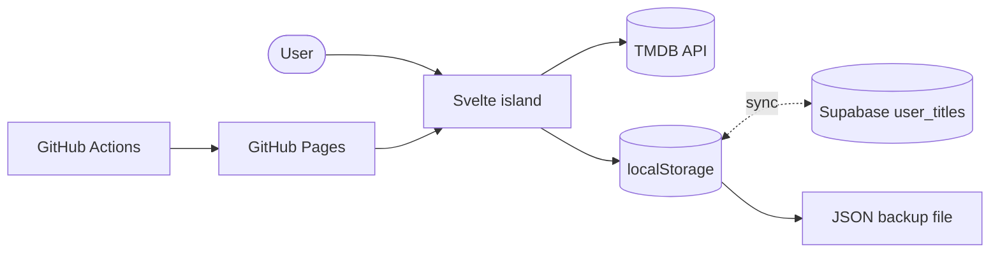

<p align="center">
  
</p>

<h1 align="center">Cortes TV</h1>

<p align="center">
  A personal movie and TV show tracker with an Apple Liquid Glass look, built for desktop and
  iPhone. A static site on GitHub Pages: titles come from TMDB, your library stays in your browser.
</p>

<p align="center">
  <a href="#features">Features</a> ·
  <a href="#tech-stack">Tech stack</a> ·
  <a href="#getting-started">Getting started</a> ·
  <a href="#documentation">Documentation</a>
</p>

---

## Features

**Recommendations**
- "Para ti" on Home: titles picked from what you watched, your star ratings, your favourite
  genres and the TMDB score, computed in the browser.

**Discover and search**
- Home rows: trending this week, top rated movies and shows, classics, now playing, popular
  shows.
- Search movies and shows (`/search/multi`) and save a result in one tap.

**Your library**
- Two lists: Pending and Watched. Mark any title from its poster or its detail.
- Rate watched titles from 1 to 5 and record the date you watched them.
- Search, filter by type and genre, sort by date, your rating, year, title or TMDB score.
- Undo a removal from the toast.

**Title detail**
- Full-screen backdrop, synopsis, genres, runtime or seasons, TMDB score, cast, where to
  watch it (`/watch/providers`) and similar titles (`/recommendations`).

**Sync**
- Optional Supabase login (email and password) that syncs the library between desktop and
  iPhone, works offline and catches up when the connection returns.

**App**
- Apple Human Interface and Liquid Glass design ([DESIGN.md](DESIGN.md)), light, dark and
  system themes with no flash on load.
- Top bar on desktop, bottom tab bar on mobile, iPhone safe areas, installable as a PWA.
- Without Supabase: an optional build-time login and data in `localStorage` only.
- JSON export and import (replace or merge), including backups from the old list format.

The UI is in Spanish.

---

## Tech stack

<p>
  
  
  
  
  
</p>

| Layer | Technology |
|---|---|
| Site and build | Astro 5, static output with one client-only island |
| UI | Svelte 5, TypeScript |
| Styling | Tailwind CSS 3 with design tokens as CSS variables |
| Data | TMDB API v3 (read only), browser `localStorage`, optional Supabase |
| Hosting | GitHub Pages, deployed by GitHub Actions |

---

## Architecture



There is no server code. The browser calls TMDB directly and keeps the user's library in
`localStorage`, one record per title with its status (pending or watched). With Supabase
configured, that copy syncs with a `user_titles` table protected by row level security, so
the same library shows on every device. Every `PUBLIC_*` variable ships in the public bundle:
use a read-only TMDB key and the Supabase anon key; the build-time login is a closed door, not
security.

---

## Getting started

Requires Node 22 and pnpm 11, plus a TMDB v3 API key from
<https://www.themoviedb.org/settings/api>.

```bash
pnpm install
cp .env.example .env      # set PUBLIC_TMDB_API_KEY; Supabase and PUBLIC_AUTH_* are optional
pnpm dev
```

| Command | Action |
|---|---|
| `pnpm dev` | Development server |
| `pnpm build` | Static build into `dist/` |
| `pnpm preview` | Serve the build |
| `pnpm check` | Type and template checks (`astro check`) |

Deploy: enable **Settings > Pages > Source: GitHub Actions**, add the `TMDB_API_KEY` secret
and, for sync, the `SUPABASE_URL` and `SUPABASE_KEY` variables, then push to `main`. Supabase
setup: [docs/operations.md](docs/operations.md#supabase). Environment variables,
base path and CI: [docs/operations.md](docs/operations.md).

---

## Project structure

```
cortes-tv/
├── src/           # Svelte components, stores and TMDB client, layout, styles
├── public/        # Logo, PWA icons and manifest
├── scripts/       # Icon generator and docs check
├── supabase/      # Database schema and row level security
├── docs/          # Domains, operations, workflow and decisions
├── DESIGN.md      # Design system
└── AGENTS.md      # Agent rules and documentation map
```

---

## Documentation

- [AGENTS.md](AGENTS.md): entry point, global rules and the map of where everything lives.
- [docs/](docs/): one file per feature domain, plus code style, workflow, operations and the
  decision log.
- [DESIGN.md](DESIGN.md): typography, color, glass, motion and components.
